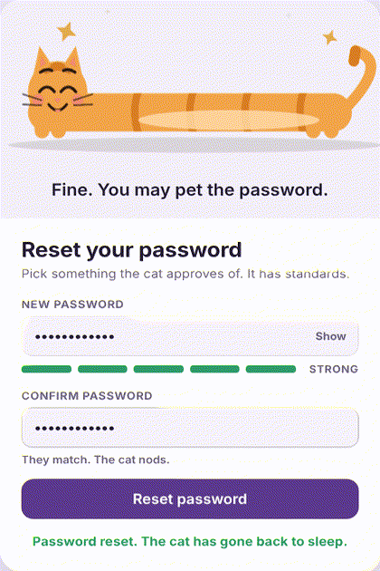

# Stretchy Cat Reset

A password-reset screen where a cartoon cat stretches and morphs as your password gets stronger, from a short grumpy loaf to a long, smug noodle, with cat-themed insults along the way.

**[Live demo](#)** · Single HTML file · No framework, no build step

## Why I built this

Password strength meters are usually a coloured bar nobody looks at. I wanted to see how much personality a single form could carry without hurting usability. The result is a micro-interaction study: the cat is the strength meter, and every state change is felt rather than read.

## What it demonstrates

- **Motion design** – custom spring physics (overshoot, wobble, squash-and-stretch) written from scratch in ~40 lines, with no animation library.
- **Procedural SVG** – the whole cat is drawn and re-drawn each frame from a handful of numbers (body length, tail curl, eye openness), so expressions and proportions blend smoothly instead of swapping sprites.
- **UX writing** – six strength states, each with rotating copy ("Too short, fur-ball." → "Meow-nificent at last.") that gives feedback without a wall of rules.
- **Accessible by default** – labelled fields, visible focus states, live-region updates for the quip, keyboard-operable show/hide, and reduced-motion support.
- **Theming** – light and dark palettes driven by CSS tokens; follows the system theme or an explicit override.
- **Responsive** – works at phone width with no horizontal scroll.

## How it works

1. The password is scored into six levels (Empty, Weak, Meh, Okay, Good, Strong).
2. Each level sets a target body length and tail curl. A spring moves the current values toward the targets, so a jump from Weak to Strong overshoots and settles instead of snapping.
3. Body height is derived from length (longer = thinner) and from velocity (fast stretch = extra thin), which is what makes it feel like rubber rather than a resize.
4. Ears, eyelids, brows, mouth, whiskers, blush and sparkles are keyed to the level; the tail idles with a sine wag.
5. The Reset button unlocks only at Good or better with a matching confirmation, and the cat hops on submit.

## Run it

Open `index.html` in any browser. Try `cat`, then `catnip123`, then `Catnip!2026` to walk the full arc.

## Stack

HTML, CSS, vanilla JavaScript, inline SVG. Fonts from Google Fonts.
